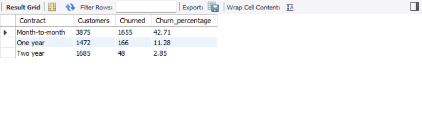
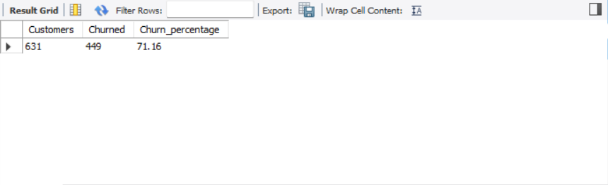
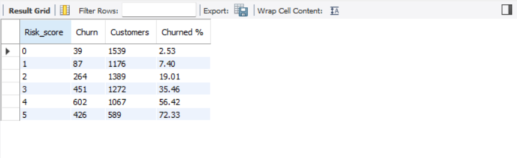
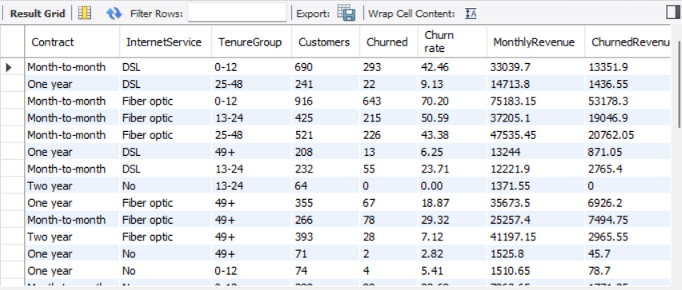

# Telco Customer Churn Analysis (SQL)

A SQL project that cleans a telecom customer dataset and answers a core business question: **who is leaving, and how much revenue does it cost?** The analysis covers churn rates by customer segment, revenue lost to churn, the highest-risk customer group, and a simple risk score.

**Tools:** MySQL, MySQL Workbench
**SQL skills used:** staging tables, data cleaning, `CASE` statements, aggregation, CTEs, subqueries, window functions (`RANK()`, running totals), views

---

## Dataset

- **Source:** IBM's Telco Customer Churn sample dataset (available on Kaggle as "Telco Customer Churn")
- **Size:** 7,043 rows and 21 columns in the original CSV; each row is one customer
- **Contents:** customer demographics, services signed up for, contract and billing details, monthly and total charges, and whether the customer churned
- **Note:** this is a sample dataset published by IBM for practice, not real company data. The findings describe this dataset only.

**Rows used:** 7,032. Eleven customers were excluded because `TotalCharges` is blank for them. All eleven have a tenure of 0 months and `Churn = No`, so they are new customers who have not been billed yet. Dropping them barely changes the churn rate (26.58% on 7,032 rows vs. 26.54% on all 7,043).

---

## Project Structure

```
telco-churn-sql/
├── README.md
├── sql/
│   ├── 01_data_cleaning.sql
│   └── 02_exploratory_analysis.sql
├── data/
│   ├── raw/
│   │   └── telco_churn.csv
│   └── cleaned/
│       └── telco_churn_cleaned.csv
└── images/
```

| File | What it does |
|---|---|
| `sql/01_data_cleaning.sql` | Builds the staging table, cleans and standardizes the data, adds helper columns, and validates the result |
| `sql/02_exploratory_analysis.sql` | Churn by segment, revenue impact, advanced queries, risk score, and the `churn_summary` view |
| `data/raw/telco_churn.csv` | The original dataset |
| `data/cleaned/telco_churn_cleaned.csv` | The cleaned table exported from MySQL (7,032 rows) |

*GitHub shows a "file too large" message instead of a table preview for the CSVs. They can still be downloaded with the Raw button.*

---

## Data Cleaning

All cleaning is done on a copy (`telco_staging`), so the imported raw table is never modified.

| Step | What was done |
|---|---|
| Staging table | Copied the raw table into `telco_staging` and worked only on the copy |
| Duplicates | Checked for repeated `customerID` values with `GROUP BY` / `HAVING`. None found. |
| Standardize `MultipleLines` | Merged "No phone service" into "No" |
| `SeniorCitizen` | Converted 0/1 to No/Yes to match the other yes/no columns |
| `ChurnFlag` | Added a 1/0 column (1 = churned) so churn can be summed and averaged |
| `TenureGroup` | Added tenure buckets: 0-12, 13-24, 25-48, and 49+ months |
| Missing totals | 11 customers with blank `TotalCharges` (tenure 0, all `Churn = No`) were excluded |
| Range checks | Tenure runs from 1 to 72 months, and monthly charges from 18.25 to 118.75 |
| Validation | Row count, unique IDs, churn counts, and group totals checked against expected values |

The "No internet service" value in `OnlineSecurity`, `OnlineBackup`, `DeviceProtection`, `TechSupport`, `StreamingTV`, and `StreamingMovies` was kept on purpose, so customers without internet can be analyzed separately from customers who have internet but skip an add-on.

---

## Key Findings

**Overall:** 1,869 of 7,032 customers churned (**26.58%**).

### Contract type is the strongest signal

| Contract | Customers | Churned | Churn rate |
|---|---|---|---|
| Month-to-month | 3,875 | 1,655 | 42.71% |
| One year | 1,472 | 166 | 11.28% |
| Two year | 1,685 | 48 | 2.85% |

Month-to-month customers churn about 15 times as often as two-year customers.



### Other segments

- **Tenure:** almost half of customers in their first year leave (47.68%). The rate falls steadily with tenure: 28.71% for 13-24 months, 20.39% for 25-48, and 9.51% for 49+.
- **Internet service:** fiber optic customers churn at 41.89%, more than twice the DSL rate (19.00%). Customers with no internet churn least (7.43%). The data cannot show why fiber churns more (price, service quality, or something else).
- **Payment method:** electronic check users churn at 45.29%, against 15.25% to 19.20% for the other three methods.
- **Add-on services:** among customers with internet, those without tech support churn at 41.65% (vs. 15.20% with it), and those without online security at 41.78% (vs. 14.64% with it).
- **Household:** senior citizens churn at 41.68% (vs. 23.65%). Customers with a partner churn at 19.72% (vs. 32.98%), and customers with dependents at 15.53% (vs. 31.28%).
- **Paperless billing:** 33.59% churn with it vs. 16.38% without.
- **Gender:** almost no difference (26.96% female, 26.20% male).

Many of these traits overlap. For example, month-to-month customers are also more likely to pay by electronic check, so these results show patterns, not independent causes.

### Revenue impact

- Churned customers paid **74.44** a month on average, against **61.31** for customers who stayed.
- Churned customers represent **139,130.85** of **455,661.00** total monthly revenue, which is **30.53%** of revenue from **26.58%** of customers.
- Month-to-month contracts bring in **56.47%** of monthly revenue but account for about **87%** of the revenue lost to churn (120,847.10 of 139,130.85).

| Contract | Share of total revenue | Share of own revenue lost to churn |
|---|---|---|
| Month-to-month | 56.47% | 46.97% |
| One year | 21.02% | 14.74% |
| Two year | 22.51% | 4.06% |

### Highest-risk segment

Customers on a **month-to-month contract with fiber optic internet, paying by electronic check, in their first 12 months**:

- **631 customers** (about 9% of all customers)
- **449 churned (71.16%)**, about 24% of everyone who churned
- Annualized revenue lost: **445,992.00** (37,166.00 per month x 12). This is revenue from customers who have already left, not a forecast.



### Segment ranking

Ranking contract and internet service combinations with a CTE and `RANK()`, the top segment is **month-to-month with fiber optic** (54.61% churn, 2,128 customers), and the lowest is **two-year with no internet** (0.79%).

### Risk score

Each customer gets 1 point for each of five risk traits: month-to-month contract, fiber optic internet, no tech support, electronic check payment, and 0-12 months of tenure.

| Risk score | Customers | Churned | Churn rate |
|---|---|---|---|
| 0 | 1,539 | 39 | 2.53% |
| 1 | 1,176 | 87 | 7.40% |
| 2 | 1,389 | 264 | 19.01% |
| 3 | 1,272 | 451 | 35.46% |
| 4 | 1,067 | 602 | 56.42% |
| 5 | 589 | 426 | 72.33% |

The churn rate rises at every step. Customers scoring 4 or 5 are about 24% of the customer base (1,656 of 7,032) but 55% of the churners (1,028 of 1,869).



### Tenure

About 31% of customers (2,175 of 7,032) have a tenure of 12 months or less. A running total by tenure (window function) ends at 7,032, matching the row count.

---

## Recommendations

These are suggestions based on the patterns above. The data shows what goes with churn, not what causes it.

1. **Move month-to-month customers to longer contracts.** This is the largest group at risk and the biggest share of lost revenue. An incentive for a one- or two-year plan targets the heaviest source of churn.
2. **Focus on the first year.** Nearly half of first-year customers leave, so onboarding and early check-ins matter most.
3. **Encourage automatic payment.** Electronic check users churn far more than customers on automatic payment methods.
4. **Look into fiber optic service.** Its churn rate is double DSL's. Pricing and service quality are worth investigating.
5. **Promote tech support and online security** to customers with internet but without them, since those customers churn at nearly three times the rate.
6. **Use the risk score** to flag customers with scores of 4 or 5 for retention outreach before they leave.

---

## Summary View

`churn_summary` is a view with one row per contract, internet service, and tenure group (35 rows), showing customers, churned customers, churn rate, monthly revenue, and churned revenue. It is designed to be read by a dashboard tool such as Power BI or Tableau.



---

## How to Run

1. Clone the repo: `git clone https://github.com/GPannu77/data-analytics.git`
2. Create a database named `telco_churn` in MySQL.
3. Import `data/raw/telco_churn.csv` into a table named `telco_raw` (MySQL Workbench's Table Data Import Wizard works). The wizard rejects the 11 rows with a blank `TotalCharges`, which leaves 7,032 rows.
4. Run `sql/01_data_cleaning.sql`. It rebuilds `telco_staging` from `telco_raw` each time, so it can be re-run.
5. Run `sql/02_exploratory_analysis.sql`. It needs the cleaning script to have been run first, because it reads from `telco_staging`.

Results are written as comments beneath each query, so you can compare your output with the expected values.

---

## Limitations

- This is IBM sample data, so the numbers may not reflect any real telecom company.
- The analysis finds patterns in churn but cannot show what causes it.
- Segments overlap, so a single trait's churn rate can reflect other traits that go with it.
- Eleven new customers with no billing history were excluded.
- The data has no dates beyond tenure, so changes over calendar time cannot be studied.
